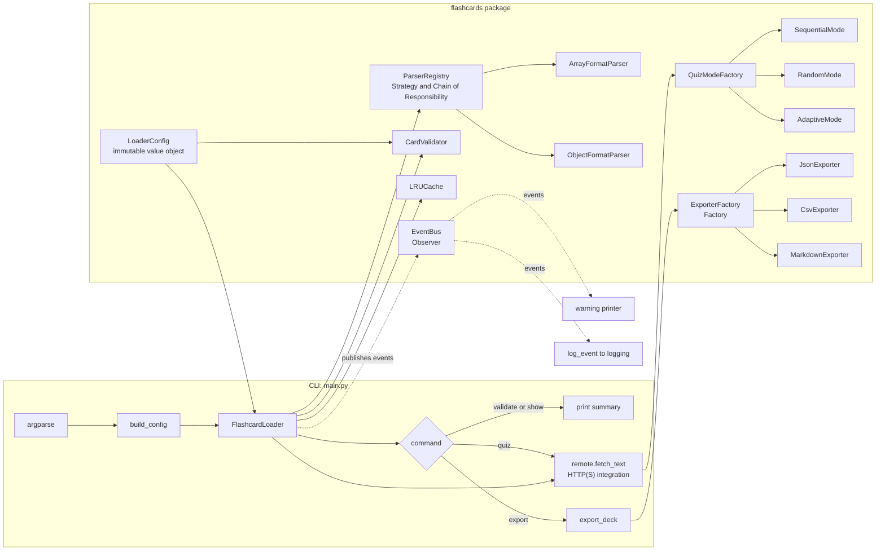
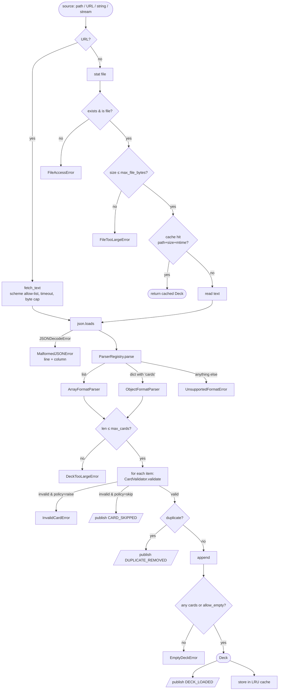
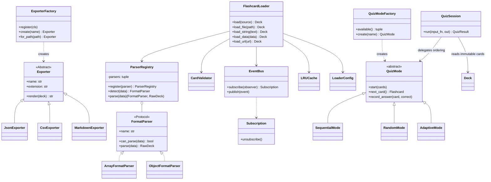
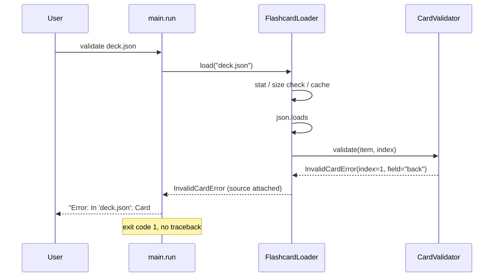
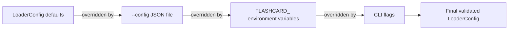

# Architecture: Flashcard Quizzer

This document explains how the `flashcards` package is put together, which
design patterns it uses and *why*, and the performance, security and
concurrency decisions behind it.

## 1. Component overview

| Module | Responsibility |
|--------|----------------|
| `models.py` | `Flashcard`, `Deck` - frozen, slotted dataclasses |
| `exceptions.py` | `FlashcardError` hierarchy with `message` + `hint` |
| `config.py` | `LoaderConfig` (defaults → JSON file → env vars → CLI flags) |
| `parsers.py` | Layout detection strategies and the registry |
| `validators.py` | Per-card type/length/content checks and normalisation |
| `loader.py` | Facade tying everything together, LRU cache |
| `events.py` | Thread-safe event bus (observer pattern) |
| `exporters.py` | JSON/CSV/Markdown exporters + atomic file writing |
| `remote.py` | Hardened HTTP(S) download |
| `logging_config.py` | Idempotent logging setup |
| `quiz.py` | Quiz strategies, factory, isolated session state and result summary |

## 2. Load pipeline

Every red-path node is a `FlashcardError` subclass. The CLI catches that one
base class, prints `exc.user_message()` (message + hint, prefixed by the
source file) and exits with status `1`. Nothing else ever reaches the user as
a traceback.

## 3. Design patterns and why they are here

| Pattern | Where | Problem it solves |
|---------|-------|-------------------|
| **Strategy** | `FormatParser` implementations | Each JSON layout has its own recognise/extract logic. New layouts are one small class; nothing else changes. |
| **Chain of Responsibility** | `ParserRegistry.detect` | Walks strategies in order; the first that *claims* the data handles it. Lets `ObjectFormatParser` own *all* dicts so it can produce the precise "missing `cards` key" message. |
| **Factory** | `ExporterFactory` | Resolves a format name or file extension to a concrete exporter; the CLI never imports exporter classes. Supports registration of custom exporters (tested). |
| **Observer** | `EventBus` | The loader reports skipped cards, duplicates, cache hits etc. without knowing about stdout or logging. The CLI subscribes a warning printer; logging subscribes `log_event`; tests subscribe `CollectingObserver`. |
| **Facade** | `FlashcardLoader` | One object hides read → parse → detect → validate → dedupe → cache. |
| **Strategy** | `QuizMode` and its three implementations | The quiz loop delegates card ordering and retry policy, keeping interaction and scoring independent from question selection. |
| **Factory** | `QuizModeFactory` | Validates a mode name and creates a fresh strategy instance for each quiz. The CLI does not branch on strategy implementation. |
| **Immutable value object** | `LoaderConfig`, `Flashcard`, `Deck` | Safe to share across threads and cache without copying. |

### Rejected: Singleton for configuration

The design-pattern guide suggests a Singleton `ConfigManager`. It was rejected
because (a) global state makes tests order-dependent, (b) it hides the
dependency, and (c) a frozen dataclass passed into the loader gives the same
"one shared config" benefit without the downsides. See the AI edit log.

Quiz strategy instances are mutable only for the lifetime of a quiz and are
created per session. A random strategy owns its own `random.Random` instance;
the immutable deck can be shared, but mutable strategy/session objects are not
shared between concurrent quizzes. Adaptive mode makes one initial pass, then
uses a queue to retry misses until correct. The user can enter `q` to stop;
the queue contains at most one pending retry per incorrect response and no
deck data is mutated.

## 4. Error-handling contract

Exit codes: `0` success · `1` user-facing problem (`FlashcardError`) ·
`2` unexpected bug (logged, still no traceback) · `130` Ctrl-C.

## 5. Performance decisions

| Decision | Rationale |
|----------|-----------|
| `stat()` before `read()` | An oversized file is rejected with one syscall instead of reading megabytes. |
| `read(max_bytes + 1)` on streams | Guards against a file that grows between `stat` and `read`, and against unbounded stdin. |
| Bounded LRU cache keyed by `(resolved path, size, mtime_ns)` | Re-validating an unchanged deck is free; a modified file is never served stale. Capacity is fixed (`cache_size`), so memory cannot grow without bound. `functools.lru_cache` was rejected because it cannot be keyed on mtime and keeps strong references forever. |
| Single validation pass, `set` for duplicates | O(n) with O(1) membership checks instead of O(n²) comparisons. |
| `slots=True` dataclasses | ~40 % less memory per card than `__dict__`-backed objects; attribute access is faster. Requires Python ≥ 3.10. |
| Local binding of `self._validator.validate` in the hot loop | Avoids repeated attribute lookups across thousands of cards. |
| Pre-compiled control-character regex at module import | One compile, reused by every thread. |

## 6. Security measures

* **Type-strict fields** - numbers/lists are rejected, never coerced to text.
* **Length limits** on every text field and on card count (`max_field_length`, `max_cards`, `max_tags`).
* **Size caps** on files, streams and HTTP responses (`max_file_bytes`).
* **Control-character filter** blocks ANSI escape injection into terminal output.
* **NFC normalisation** prevents look-alike duplicates and inconsistent comparisons.
* **URL scheme allow-list** (`http`, `https`) - `file://` and `ftp://` are refused with a clear message.
* **CSV formula-injection protection** - cells starting with `= + - @ \t \r` are prefixed with `'`.
* **Atomic export** via temp file + `os.replace`, so a crash cannot leave a half-written file.
* **Friendly errors only** - no stack traces leak file paths or internals; `--debug` opts in to logging.

## 7. Thread safety and memory hygiene

| Component | Mechanism |
|-----------|-----------|
| `Flashcard`, `Deck`, `LoaderConfig`, `ParserRegistry` | Immutable → freely shareable. |
| `LRUCache` | `OrderedDict` behind a `threading.Lock`; hard capacity. |
| `EventBus` | Observer dict behind a lock; publish iterates a snapshot *outside* the lock so observers may (un)subscribe re-entrantly; observer exceptions are isolated and logged. |
| `Subscription` | Explicit `unsubscribe()` / context manager - prevents the "observer list grows forever" leak (verified with `weakref` in tests). |
| `ExporterFactory` | Registry dict behind a lock. |
| `configure_logging` | Removes/closes handlers it installed before adding new ones - repeated calls never accumulate handlers. |
| `export_deck` | Temp file is unlinked in `finally` if `os.replace` fails. |
| `tracemalloc` test | 200 repeated loads show < 64 KiB growth after warm-up. |

## 8. Configuration precedence

All layers are validated by the same `__post_init__`, so a bad value anywhere
produces a `ConfigError` with a hint rather than a crash deep inside the loader.
